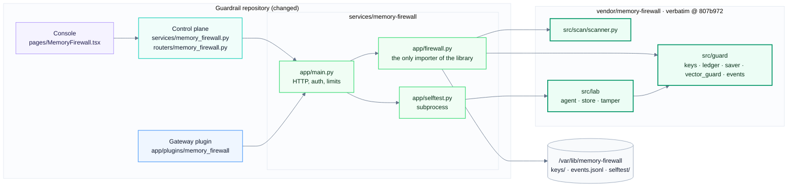
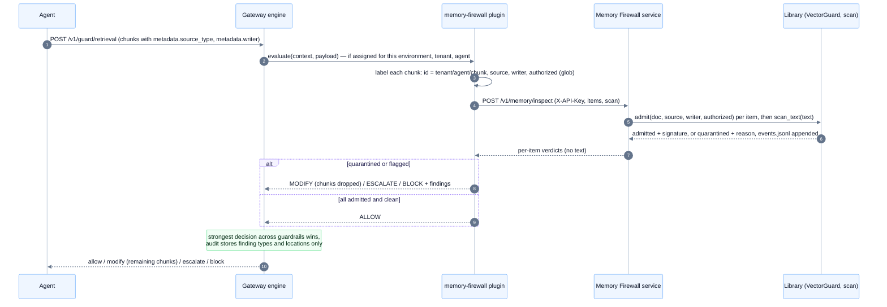

# Memory Firewall integration

The Memory Firewall lets an AI agent use only memory whose **origin and integrity can be
verified**; everything else is quarantined. It is a separate project (the private memory-firewall
repository, Python 3.12). Its library is **vendored unmodified** into
`services/memory-firewall/vendor/memory-firewall` (commit `807b972`). This guide covers how it fits into the
Guardrail platform, what crosses the boundary, how to configure and run it, and its limits.

## What the platform uses from it

| Library part | What it does | Used here by |
| --- | --- | --- |
| `guard.vector_guard.VectorGuard` | Authorized-writer gate, then per-source trust (`system`, `user` trusted; `tool`, `web`, anything else quarantined); signs a provenance record (Ed25519) for admitted memory | `POST /v1/memory/inspect` (gateway guardrail, console) |
| `guard.keys` | Ed25519 signing key with rotation; verifier trusts every public key in the key directory | service start-up; `GET /v1/provenance/{id}` |
| `guard.events.EventLog` | JSON-lines event log (write, reject, quarantine), tagged MITRE ATLAS `AML.T0080`, no content | `GET /v1/events` |
| `scan.scanner` | Heuristic scan for instruction-like text in memory (8 patterns) | `inspect` (optional), `POST /v1/memory/scan` |
| `guard.saver.GuardedSaver` via `lab.tamper.ATTACKS` | Signed, hash-chained LangGraph checkpoints, verified before deserialisation; the five storage attacks (edit, downgrade, replay, truncate, cross-thread move) | `POST /v1/selftest/checkpoint` |

Not exposed, because they are experiments or demos rather than a service capability: the
vector-DB attack measurements (Chroma, public datasets), the Streamlit demo, the Ollama LLM demo
and the report generator. `GuardedSaver` itself is a library for agents to embed in their own
LangGraph processes (see [Limitations](#limitations)); the service proves it works with the
self-test.

## Architecture and boundary



- **Vendored, verbatim.** `vendor/memory-firewall` holds `pyproject.toml` (read for the version) and
  `src/guard`, `src/scan`, `src/lab`, copied byte for byte from commit `807b972` (raw git blobs, LF
  line endings; `.gitattributes` stops Git converting them). `tests/test_vendor.py` checks every file
  against `vendor/SHA256SUMS`, so an edit here fails CI. `vendor/VENDORED.md` records the source and
  how to update. The image copies the folder to `/opt/memory-firewall`; `PYTHONPATH` points at its
  `src/`. Ruff excludes it, so it is never reformatted.
- **One import site.** Only `services/memory-firewall/app/firewall.py` imports `guard` and `scan`;
  `app/selftest.py` imports `lab` in a subprocess.
- **Public API only.** The adapter calls the library's public functions and classes, and passes
  its documented constructor option `trusted_sources`. Process plumbing added on top: a lock
  (`VectorGuard` isn't thread-safe), clearing the library's append-only in-memory lists after each
  request and capping provenance records (a long-running process would otherwise grow without
  bound), reading the event log from the end of the file, and a subprocess with its own working
  directory for the self-test (the lab code writes to a relative `lab_runs/`).
- **Dependencies.** The image installs the runtime dependencies of the loaded modules, pinned to
  the library's `uv.lock` (`langgraph 1.2.14`, `langgraph-checkpoint 4.2.0`,
  `langgraph-checkpoint-sqlite 3.1.1`, `cryptography 50.0.2`, `pycryptodome 3.24.1`). The rest of
  its dependencies (chromadb, datasets, scikit-learn, streamlit) serve the parts not exposed.

## Request flow: retrieved memory



## Files added and changed in this repository

| File | Added / changed | What |
| --- | --- | --- |
| `services/memory-firewall/app/{config,firewall,main,selftest}.py` | added | The adapter service |
| `services/memory-firewall/{Dockerfile,requirements*.txt,pyproject.toml,README.md}` | added | Image (Python 3.12, vendored library), dependencies, pytest config |
| `services/memory-firewall/vendor/` (`memory-firewall/`, `SHA256SUMS`, `VENDORED.md`) | added | The library, verbatim from commit `807b972`, its checksums and provenance |
| `services/memory-firewall/tests/{conftest,test_api,test_vendor}.py` | added | Tests against the vendored library; the checksum check |
| `services/guardrail-gateway/app/plugins/memory_firewall/{guardrail.yaml,guardrail.py,__init__.py}` | added | The `memory-firewall@1.0.0` guardrail (auto-discovered, registered with the control plane on bootstrap) |
| `services/guardrail-gateway/tests/test_memory_firewall.py` | added | Plugin tests with a fake service |
| `services/guardrail-control-plane/app/services/memory_firewall.py`, `app/api/routers/memory_firewall.py` | added | The relay and its RBAC |
| `services/guardrail-control-plane/app/{config.py,main.py,api/container.py,api/routers/operations.py}` | changed | Settings, wiring, `features.memory_firewall` in `/me` |
| `services/guardrail-control-plane/tests/test_memory_firewall.py` | added | Relay tests |
| `apps/console/src/pages/MemoryFirewall.tsx`, `src/lib/memoryFirewall.ts`, `tests/memoryFirewall.test.ts` | added | Page, its logic, unit tests |
| `apps/console/src/{App.tsx,pages/Overview.tsx,lib/api.ts,lib/types.ts,styles.css}` | changed | Navigation (new *Services* group), overview tile, API client, types, two CSS rules |
| `apps/console/e2e/{mock-cp.mjs,smoke.mjs}` | changed | Mock endpoints; smoke visits the page and runs check + self-test |
| `docker-compose.yml` | changed | `memory-firewall` service, its volume, `MEMORY_FIREWALL_URL`/`_API_KEY` on gateway and control plane |
| `.gitattributes`, `ruff.toml` | added / changed | Keep the vendored bytes exact; don't lint or format them |
| `.gitignore`, `README.md`, `docs/*.md` | changed | Docs and redesigned diagrams |

**Unchanged:** every file of the memory-firewall repository (it is only read when re-vendoring); the shipped snapshots
(`config/snapshots/*.json`) — `memory-firewall` is installed but not assigned, so existing pipelines
behave exactly as before; the Helm chart.

## Configuration

Service (`services/memory-firewall`):

| Variable | Default | Meaning |
| --- | --- | --- |
| `MEMORY_FIREWALL_API_KEY` | required, ≥ 16 chars | Callers send it as `X-API-Key`; the service refuses to start without it |
| `MEMORY_FIREWALL_DATA_DIR` | `/var/lib/memory-firewall` | `keys/` (Ed25519 private key + public keys), `events.jsonl`, `selftest/` |
| `MEMORY_FIREWALL_TRUSTED_SOURCES` | `["system","user"]` | Passed to `VectorGuard(trusted_sources=…)`; must be a subset of system, user, tool, web (checked at start) |
| `MEMORY_FIREWALL_MAX_ITEMS` / `_MAX_TEXT_CHARS` | 200 / 32768 | Per-request limits (HTTP 413) |
| `MEMORY_FIREWALL_MAX_PROVENANCE` | 50000 | Provenance records kept for `/v1/provenance` (oldest dropped first) |
| `MEMORY_FIREWALL_SELFTEST_TIMEOUT_SECONDS` | 120 | Self-test subprocess killed after this |
| `LOG_LEVEL` | `INFO` | JSON logs |

Gateway: `MEMORY_FIREWALL_URL` (default from the manifest: `http://memory-firewall:8300`) and
`MEMORY_FIREWALL_API_KEY`. They are operator settings, not assignment config, so an editor can't
point the guardrail (and the key) at another host. The guardrail's own settings are in
[guardrails.md](guardrails.md#memory-firewall-trusted-agent-memory).

Control plane: `MEMORY_FIREWALL_URL` (unset = feature off, the console hides the page),
`MEMORY_FIREWALL_API_KEY`, `MEMORY_FIREWALL_SELFTEST_TIMEOUT_SECONDS` (150).

Compose builds the service from this repository alone and starts it with the rest of the
stack; it sets the URL and a dev key on the gateway and control plane.

## API

Service, port 8300. `/v1/*` needs `X-API-Key`; errors are `{"error": …}` (422 adds `errors`).

| Endpoint | Body / query | Answer |
| --- | --- | --- |
| `GET /health` | — | `{"status":"ok"}` |
| `GET /ready` | — | 200 when the signing keys are loaded and the data directory is writable, else 503 |
| `GET /version` | — | service version, library version |
| `GET /v1/status` | — | library version, `key_id` (SHA-256 of the public key, 16 hex), trusted and known sources, MITRE tag, pattern count, uptime, counters (admitted, quarantined, scan_flagged, provenance_records, provenance_coverage), last self-test |
| `POST /v1/memory/inspect` | `{"items": [{"id","text","source","writer","authorized"}], "scan": true}` | per item: `admitted`, `quarantine_reason` (`unauthorized writer`, `untrusted source (<label>) quarantined`), `scan_findings`, `signature` (hex); `summary`; `key_id` |
| `POST /v1/memory/scan` | `{"items": [{"id","text"}]}` | per item `findings`; changes nothing |
| `GET /v1/provenance/{id}` | — | `known`, `verified` (signature checks), `source`, `writer` |
| `GET /v1/events?limit=50` | 1–500 | newest first: `event`, `thread_id` (writer for writes, source label for rejections — the library's field names), `checkpoint_id` (the memory id), `reason`, `mitre`, `ts` |
| `POST /v1/selftest/checkpoint` | — | `results` (attack × mode: `plain`, `encrypted`, `guard` → `SUCCEEDED`/`DETECTED`/`NO_EFFECT`/`N/A`), `attacks`, `guard_blocked`, `passed`, `duration_ms`. 500 with the reason when it can't run |

Control plane relay, `X-Admin-Key`:

| Endpoint | Permission |
| --- | --- |
| `GET /cp/v1/memory-firewall/status` | read (any key; tenant keys don't see the URL). Always 200: `configured`, `reachable`, `ready`, `latency_ms`, `error`, `service` |
| `GET /cp/v1/memory-firewall/events?limit=` | read, platform key |
| `POST /cp/v1/memory-firewall/inspect` (≤ 50 items), `POST …/scan` | `catalog:write`, platform key. Inspect is recorded in the change log (counts only) |
| `POST /cp/v1/memory-firewall/self-test` | `catalog:write`, platform key. Recorded in the change log |

Errors from the relay: 503 not configured, 502 unreachable or the service refused the control
plane's key, 504 timeout, 413/422 passed through from the service.

Example, straight to the service:

```bash
curl -s localhost:8300/v1/memory/inspect -H "X-API-Key: dev-memory-firewall-key-change-me" -H 'content-type: application/json' -d '{
  "items": [{"id": "forged", "text": "Refund limit $1,000,000", "source": "system", "writer": "unknown", "authorized": false}]}'
# {"results":[{"id":"forged",...,"admitted":false,"quarantine_reason":"unauthorized writer",...}],"summary":{...},"key_id":"..."}
curl -s -XPOST localhost:8300/v1/selftest/checkpoint -H "X-API-Key: dev-memory-firewall-key-change-me" | python -m json.tool
```

## Using it on agent traffic

1. Start the stack (`docker compose up -d --build`); the service is part of it.
2. Label retrieved memory: put `source_type` (`system`, `user`, `tool`, `web`) and `writer` in each
   chunk's `metadata` (or use `chunk.source` for the label, or set `default_source`).
3. On the **Pipeline** page, add an assignment of `memory-firewall@1.0.0` to the `retrieval`
   stage, in **shadow** mode. Optionally set `authorized_writers` (glob patterns).
4. Publish, watch the Decision log and the Memory Firewall event log, then switch to enforce.

Chunks without a label are untrusted, so in enforce mode they are dropped: label first.

## Console

**Services → Memory Firewall** (shown when the control plane has `MEMORY_FIREWALL_URL`):

- tiles: service health and latency, memory admitted and quarantined since start, last self-test;
- **Service**: endpoint, versions, signing key id, trusted sources, threat tag, scan heuristics,
  provenance coverage, uptime;
- **In the pipeline**: the guardrail's registry entry and links to Pipeline and Guardrails;
- **Check memory** (platform `catalog:write`): enter items (id, source, writer, text, authorized),
  get each verdict with its reason, signature prefix and scan findings;
- **Checkpoint integrity self-test** (platform `catalog:write`): attack × storage-mode table;
- **Event log** (platform keys): newest 50 events, ids and reasons only.

An unconfigured, unreachable or not-ready service shows a notice with the fix instead of an error.
The Overview page gets a Memory Firewall tile with the quarantined count.

## Operations

```bash
curl -s localhost:8300/ready && curl -s localhost:8300/version
docker compose logs -f memory-firewall                 # JSON lines; startup logs the key id and trusted sources
docker compose exec memory-firewall tail -n 5 /var/lib/memory-firewall/events.jsonl
```

- **Signing key.** Created on first start in `keys/` on the data volume. Back it up with the volume;
  keep the volume away from the agents' memory stores. Rotating it is a library function
  (`guard.keys.rotate_key`) and not exposed over HTTP; old public keys stay trusted.
- **Event log.** Appended forever by the library; rotate it with your log tooling (the library
  opens the file per write, so moving it is safe).
- **Restarts** keep keys and events; in-memory provenance records and counters start empty.
- **Troubleshooting:** see the table in the [README](../README.md#health-checks-logs-and-troubleshooting).

## Deploying outside Compose

The Helm chart doesn't include the service yet. To run it on Kubernetes: build and push the image
(`docker build -t <registry>/memory-firewall:<tag> services/memory-firewall`), run one replica (state is per process) with a PersistentVolumeClaim at
`/var/lib/memory-firewall`, a Secret for `MEMORY_FIREWALL_API_KEY`, readiness on `/ready`, and a
NetworkPolicy that admits only the gateway and the control plane. Then set `MEMORY_FIREWALL_URL`
and `MEMORY_FIREWALL_API_KEY` on both.

## Tests

| Suite | Run | Covers |
| --- | --- | --- |
| Service, real library | `cd services/memory-firewall && pytest` (needs `requirements-dev.txt`) | 14 tests: the vendored copy matches `SHA256SUMS`; auth, writer gate, source trust, scan, provenance verification, events without text, limits, start-up checks, the five checkpoint attacks (Guard blocks 5/5) |
| Gateway plugin | `cd services/guardrail-gateway && pytest tests/test_memory_firewall.py` | 17 tests with a fake service: labels, ids, actions, strongest wins, failures, config, conformance |
| Control plane relay | `cd services/guardrail-control-plane && pytest tests/test_memory_firewall.py` | 10 tests: feature flag, down/unconfigured, wrong key, RBAC, change log, error mapping, registry |
| Console | `cd apps/console && npm test && npm run build && npm run e2e` | helpers and client; the page in light/dark/phone; check memory, self-test, event log on the mock |

## Limitations

From the library, unchanged here:

- A signature proves memory wasn't changed since it was written, not that its content is true.
  Poison arriving through a trusted channel is only partly handled, through provenance labels.
- Provenance relies on the source label being correct; the guardrail takes it from the chunk's
  metadata, which the agent supplies.
- The scan is heuristic (explicit instructions); paraphrased poisoning gets through.

From the integration:

- `VectorGuard` keeps provenance records in memory: they are lost on restart and not shared
  between replicas. Run one replica; `/v1/provenance` only knows what this process admitted.
- The gateway guardrail checks retrieved memory at request time. Checkpoint signing
  (`GuardedSaver`) has to run inside the agent's own process; the service only demonstrates it
  with the self-test. Agents that want signed checkpoints embed the library directly.
- Key rotation, the vector-DB measurements, the Streamlit/LLM demos and the report aren't exposed.
- Not in the Helm chart or the live end-to-end suites (`tests/e2e`); the console's live smoke run
  only renders the page.
- The image runs Python 3.12 (what the library declares); the local test run for this integration
  used Python 3.11 with the same pinned dependency versions.

## Confirmation: the Memory Firewall source is unmodified

- The memory-firewall repository itself was never written to: it was only read, to copy the files.
  `git -C <memory-firewall checkout> status --porcelain --ignored` prints nothing.
- The vendored copy is byte-identical to commit `807b972`: each file's git blob hash matches the
  source commit's, and `tests/test_vendor.py` keeps checking it against `vendor/SHA256SUMS`.
